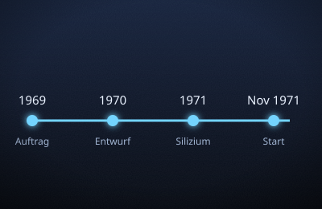
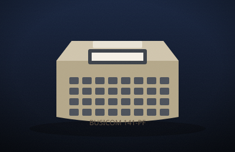
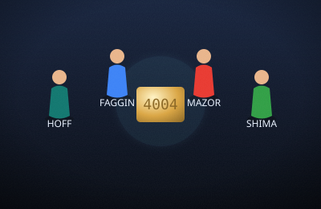

# Lektion 1: Wie er erfunden wurde

**Zeit:** 10 Minuten. **Du brauchst:** nichts.

## Kurz gesagt

Ein Taschenrechner brauchte viele Chips.
Vier Menschen machten daraus einen Chip mit Programm.
Das war der Intel 4004.

## Der Auftrag

Im April 1969 fragte die Firma Busicom bei Intel an.
Sie wollten Chips für einen Tischrechner.
Geplant waren bis zu zwölf verschiedene Chips.
Der Ingenieur Tadashi Sasaki hatte die Idee dazu.

## Die neue Idee

Ted Hoff arbeitete bei Intel. Er fand den Plan zu groß.
Zwölf Chips waren zu teuer und zu schwer zu verdrahten.
Er schlug vier Chips vor. Einer davon war programmierbar.
Das Programm machte aus dem Chip einen Rechner.
Stan Mazor und Masatoshi Shima halfen beim Entwurf.

## Der Bau

Im April 1970 kam Federico Faggin zu Intel.
Er übernahm die Leitung. Er kannte eine neue Bauart.
Sie hieß Silizium-Gate. Er hatte sie selbst entwickelt.

Ende 1970 kamen die ersten Chips. Sie taten nichts.
Eine Stufe war vergessen worden. Im Januar 1971 liefen sie.
Im März 1971 war der erste 4004 fertig.
Er steckte im Prototyp des Rechners 141-PF.

Der Rechner steht heute in einem Museum in Kalifornien.

## Der Start

Im August 1971 begann die Fertigstellung in Mengen.
Am 15. November 1971 kam der 4004 auf den Markt.
Er kostete 60 Dollar.

Intel kaufte die Rechte zurück. Das kostete 60.000 Dollar.
Busicom durfte nur Rechner bauen.
Busicom ging 1974 pleite.

## Probier es

1. Nenne zwei Dinge, die sich 1969 und 1971 änderten.
2. Warum war ein Chip mit Programm billiger?
3. Erkläre es in einem Satz.

## Frag mich

Frag den Agenten: „Warum wollte Hoff nur vier Chips?"
