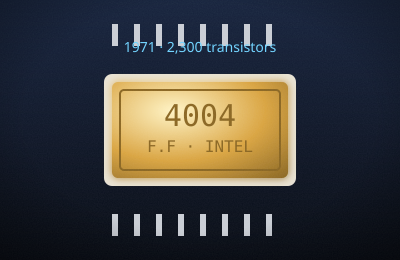
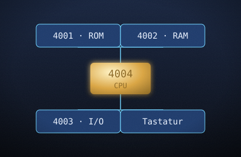
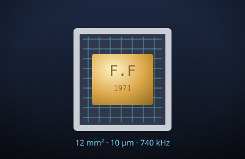

# Lektion 2: Wie er aufgebaut ist

**Zeit:** 12 Minuten. **Du brauchst:** Lektion 1.

## Kurz gesagt

Der 4004 war klein und langsam.
Aber er war ein ganzes Rechenhirn auf einem Stück Silizium.

## Die Zahlen

| Was | Wert |
| --- | --- |
| Jahr | 1971 |
| Transistoren | 2.300 |
| Größe | 12 mm² |
| Bauart | 10 µm |
| Takt | 740 kHz |
| Befehle | rund 92.000 pro Sekunde |
| Pins | 16 |
| Daten | 4 Bit |

Ein Befehl dauerte 10,8 Mikrosekunden.
Das ist heute sehr langsam. Damals war es schnell.

## Warum vier Bit?

Der Chip war für einen Rechner gedacht.
Rechner rechnen mit Ziffern von 0 bis 9.
Vier Bit passen gut zu einer Ziffer.
Darum wählte man vier Bit.

## Die Tricks

Faggin nutzte Silizium-Gate. Das machte den Chip dichter.
Er erfand auch zwei neue Schritte. Sie hießen buried contact
und bootstrap load. Zusammen verdoppelten sie die Dichte.
Der Chip wurde fünfmal schneller als ältere Bauarten.

Hoff hatte eine andere Idee. Viele Befehle ähnelten sich.
Er lieferte sie als Unterprogramme aus. Das sparte Platz.

## Das Chip-Set

Der 4004 arbeitete nicht allein.

- **4004** — das Rechenhirn.
- **4001** — der Speicher für das Programm. 256 Byte.
- **4002** — der Speicher für Daten. 40 Byte.
- **4003** — die Ein- und Ausgabe. Für Tasten und Drucker.

Man konnte bis zu 16 Chips von jeder Art anschließen.
So entstand ein ganzer Rechner aus vier Chip-Arten.

## Die Unterschrift

Faggin schrieb seine Initialen auf den Chip: F.F.
Er war der erste, der einen Chip signierte.
Viele andere machten es ihm nach.

## Probier es

1. Wie viele Transistoren hatte der 4004?
2. Warum vier Bit?
3. Welche Aufgabe hatte der 4001?

## Frag mich

Frag den Agenten: „Erkläre 4 Bit in einfachen Worten."
