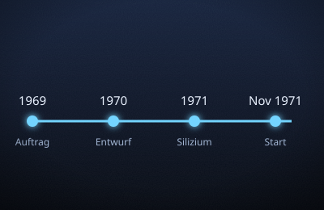

# Lektion 3: Wer war zuerst?

**Zeit:** 8 Minuten. **Du brauchst:** Lektion 1.

## Kurz gesagt

Viele Leute streiten über den ersten Chip mit Rechenhirn.
Die Antwort hängt davon ab, was man „erster" nennt.
Der 4004 war der erste, den man kaufen konnte.

## Die Kandidaten

| Jahr | Was | Wer |
| --- | --- | --- |
| 1969 | AL1, ein Rechenwerk | Four-Phase Systems |
| 1970 | MP944 für ein Flugzeug | Garrett AiResearch |
| 1971 | TMS 1802NC | Texas Instruments |
| 1971 | Intel 4004 | Intel |

## Was jeder meint

Die AL1 von 1969 war nur ein Rechenwerk.
Sie war kein ganzes Rechenhirn auf einem Chip.

Der MP944 von 1970 war für ein Kampfflugzeug.
Er war geheim. Er bestand aus mehreren Chips.

Der TMS 1802NC kam im September 1971.
Er war ein Chip für eine bestimmte Aufgabe.
Man nennt ihn den ersten Chip für eine Aufgabe.

Der 4004 kam im November 1971.
Er war der erste weit verkaufte Chip mit Programm.

## Ein weiterer Fall

Gilbert Hyatt meldete 1990 ein Patent an.
Sein Entwurf von 1969 wurde nie gebaut.
Es gab jahrelange Prozesse. Manche nennen ihn einen
Miterfinder. Andere nicht.

## Die ehrliche Antwort

Es gibt keine einzige Antwort.
Man kann fragen: Wer war zuerst?
Man kann auch fragen: Wer war zuerst zu kaufen?

Für die zweite Frage ist der 4004 die Antwort.
Das sagen Museen und viele Fachleute.

So war es auch beim integrierten Schaltkreis.
Kilby machte die Idee zuerst. Noyce machte sie praktisch.
Beide gelten als Erfinder.

## Probier es

1. Nenne zwei Kandidaten für den ersten Chip.
2. Warum ist die Frage schwierig?
3. Welcher Chip war zuerst im Laden?

## Frag mich

Frag den Agenten: „Warum gibt es hier keinen klaren Sieger?"
