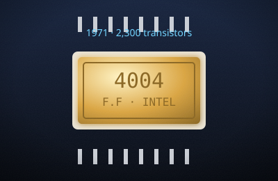

# Der erste Mikrochip

Ein kurzer Kurs über den Intel 4004.
Er kam 1971. Er war der erste weit verkaufte Chip mit einem Rechenhirn.

## Lektionen

1. [Wie er erfunden wurde](01-erfindung.md)
2. [Wie er aufgebaut ist](02-design.md)
3. [Wer war zuerst?](03-wer-zuerst.md)

## Was du lernst

- Ein Auftrag aus Japan.
- Eine neue Idee statt vieler Chips.
- Vier Menschen und ein Chip.
- Zahlen, Aufbau und ein kleiner Streit.

## Hinweis

Dieser Kurs ist offen. Alle Bilder sind selbst gezeichnet.
Er ist noch nicht mit echten Nutzern getestet.
