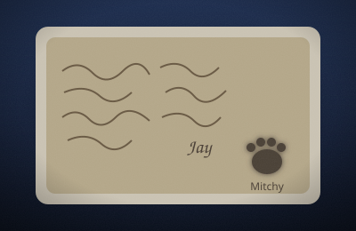
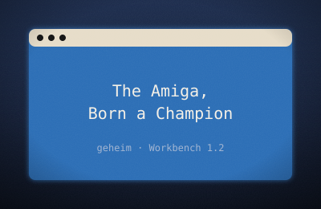

# Die Poesie von Hi-Toro und dem Amiga-Team

Hi-Toro war der erste Name der Firma.
Spanisch heißt das „großer Stier".
Später hieß sie Amiga. Das heißt „Freundin".

Hier geht es nicht nur um Gedichte auf Papier.
Es geht um Wörter, Namen und Zeichen im Gerät.
Das nenne ich die Poesie dieses Teams.

## 1. Die Namen

Der neue Rechner hieß im Geheimen Lorraine.
Das war der Name von Dave Morses Frau.

Die drei Chips bekamen Frauennamen: Agnus, Denise und Paula.
Der Grund war ein Trick. Am Telefon sollte niemand etwas merken.
Niemand sollte Computerteile erraten.
„Agnes ist schlecht gelaunt" klang wie ein Witz.
Den Ingenieuren gefiel das.

Agnus kommt vom lateinischen Agnus Dei. Das heißt
„Lamm Gottes". Jay Miner war ein gläubiger Mensch.

Der Firma Hi-Toro gehörte der Name schon jemand anderem.
Eine japanische Firma für Rasenmäher hieß so.
Jay schlug „Amiga" vor. Es klang freundlich.
Und im Telefonbuch stand Amiga vor Atari.

## 2. Das Geheimnis

Die Firma baute zuerst Zubehör für Spielgeräte.
Das war ein Tarnung. Es gab auch einen Spaß:
das Joyboard. Man saß darauf und bewegte sich.
RJ Mical schrieb dazu ein Spiel. Es hieß
„Zen Meditation". Man sollte ganz still sitzen.

Daraus wurde später eine Fehlermeldung im System:
„Guru Meditation Error". Der Guru kam von diesem Spaß.
Ein Chef von Commodore strich den Guru später weg.
Daraus wurde nur noch „Software Failure".

## 3. Der Humor

Jay verglich die junge Firma mit dem Zauberlehrling.
Im Film Fantasia macht er Besen, die immer mehr werden.
So fühlte sich das Team. Die Ideen wuchsen schnell.
Die Zeit war zu kurz.

In den Besprechungen lagen Schläger aus Schaumgummi.
Wer eine Idee vorstellte, konnte einen Schlag bekommen.
Jay sagte: „Es tat nicht weh. Aber die Schande war schlimm."

Auch die Chips durften schlecht gelaunt sein.
Das war erlaubter Spaß.

## 4. Die Namen im Gehäuse



Im Amiga 1000 stehen die Namen des Teams.
Sie sind in den Kunststoff gegossen.
Auch Jay Miners Hund Mitchy ist dabei.
Ihre Pfote ist abgebildet. Mitchy hatte sogar
einen eigenen Ausweis bei Atari.

Das ist Poesie aus Kunststoff.
Es sagt: Wir haben das gemacht. Wir sind stolz.

## 5. Die versteckten Worte



In Workbench 1.2 gab es einen geheimen Kniff.
Man hielt beide Alt-Tasten und beide Shift-Tasten.
Dann drückte man F1 bis F10.
Es erschienen Namen und Gruppen:

- F1: System Software: Carl, Neil und Kodiak.
- F2: Grafik: Dale, Bart, Jim und RJ.
- F8: Chips: Jay, Akio, Glenn, Edwin, Mark und Dave.
- F10: Moral Support: Joe Pillow und die Dancing Fools.

Dann kam der Satz: „The Amiga, Born a Champion".
In Version 1.2 stand auch ein derber Satz über Commodore.
In 1.3 wurde er milder: „Still a Champion".

Ein anderer Text nannte Dale Luck einen
„Wizard Extraordinaire". RJ Mical wurde Vater.
Dann stand ein Glückwunsch für RJ im Bildschirm.

## 6. Das echte Gedicht

In AmigaOS 3.5 versteckte jemand ein Gedicht.
Es war mit rot13 verschlüsselt. Das heißt:
Jeder Buchstabe ist um 13 Stellen verschoben.

Der Text stammt von Bert Brecht. Die Musik schrieb Kurt Weill.

> Denn die einen sind im Dunkeln
> Und die andern sind im Licht.
> Und man siehet die im Lichte,
> Die im Dunkeln sieht man nicht.

Das ist echte Poesie im Betriebssystem.
Jemand wollte, dass ein paar Worte übrig bleiben.

Es gab noch mehr Zeilen.
Ein Lied hieß: Do You Know The Way To San José.
Ein anderes hieß: God Only Knows.
Das sind Liedtitel.
Ein Programm hieß „Nicole" nach einer Mitarbeiterin.

## 7. Poesie im Chip

Auch die Technik hatte schöne Namen.

- **HAM** hieß „Hold And Modify". Es zeigte 4.096 Farben.
  Der Chipbauer sagte: Ohne HAM bleibt ein häßliches Loch.
  Jay behielt HAM. Das war richtig.
- **Copper** war ein kleiner Rechner mit drei Befehlen.
  Er malte Streifen im Takt des Bildschirms.
- **Blitter** kam von Jays Liebe zu Flugspielen.
  Er konnte Bilder schnell verschieben.

Und der Boing Ball? Er war nie offiziell das Logo.
Commodore nahm das bunte Zeichen.
Die Menschen behielten die Kugel im Herzen.
Das ist auch Poesie.

## 8. Was wir daraus lernen

1. Names dürfen Geschichten tragen.
2. Spaß und Stolz gehören zur Technik dazu.
3. Wer etwas baut, darf es signieren.
4. Ein verstecktes Wort kann lange Freude machen.
5. Schönheit sitzt auch im Tun, nicht nur im Bild.

Unser Projekt signiert seine Arbeit auch.
Alle Bilder und Lieder sind selbst gemacht.
Das steht in `PERMISSIONS.md`.

## Quellen

```text
Ars Technica (Geschichte des Amiga, Teil 2)
Wikipedia (Easter Eggs in Medien)
Amiga History Guide (versteckte Botschaften)
Computer History Museum (Jay Miner)
Lemon Amiga (Jay Miner)
Wikiwand (Amiga)
```

## Weiterlesen

- `../design-history.md` — Design aus der Retro-Scene.
- Die ganze Chronik steht im Ordner `learn`.
